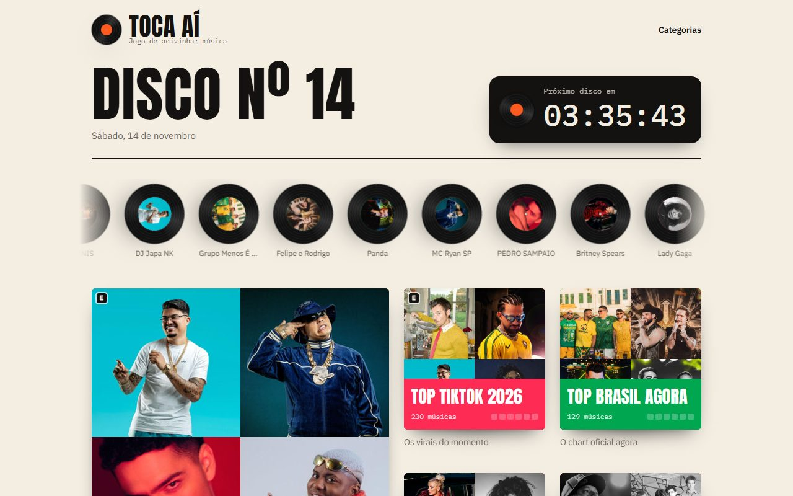
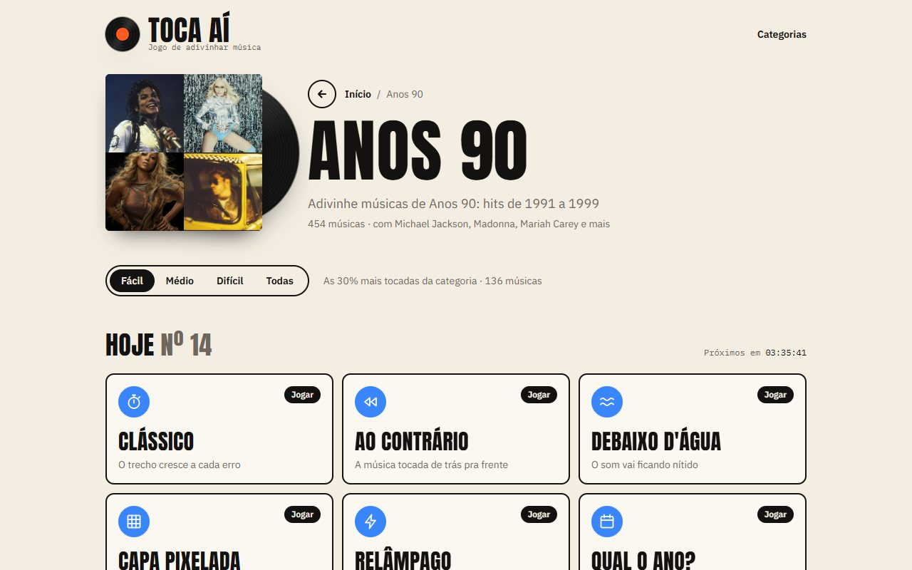
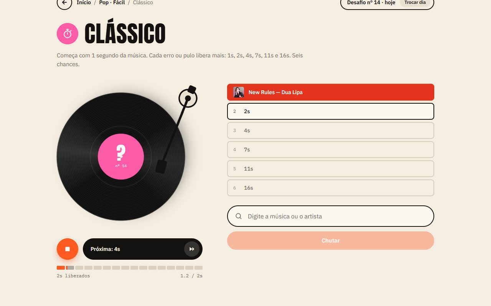
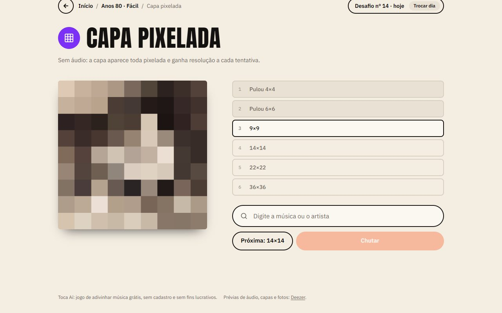
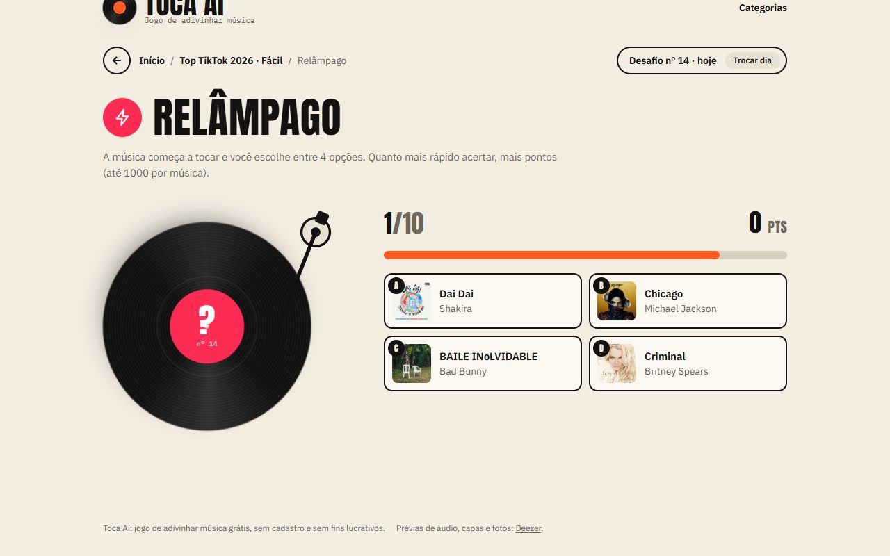
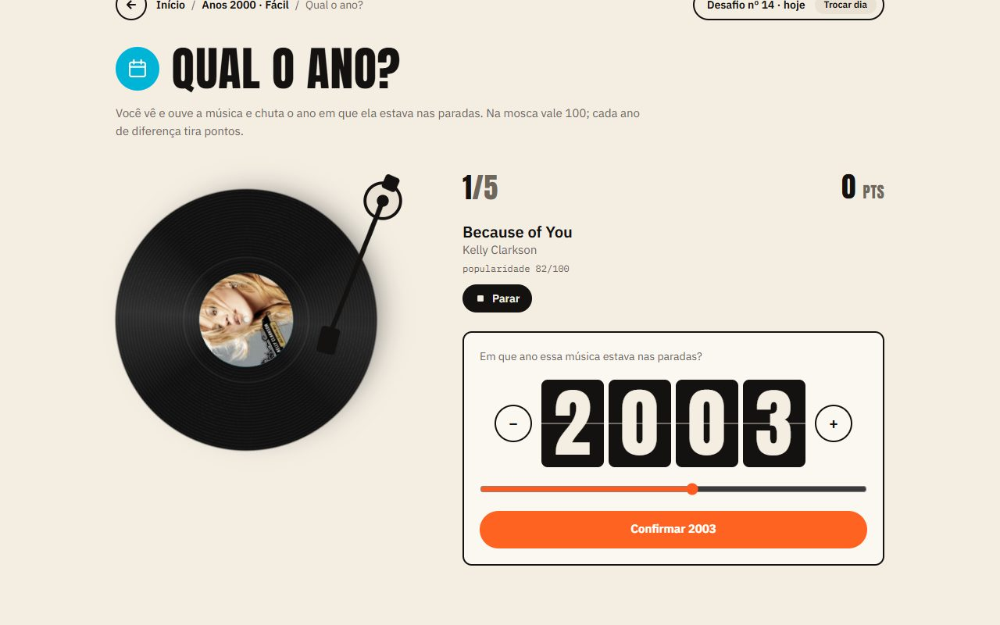
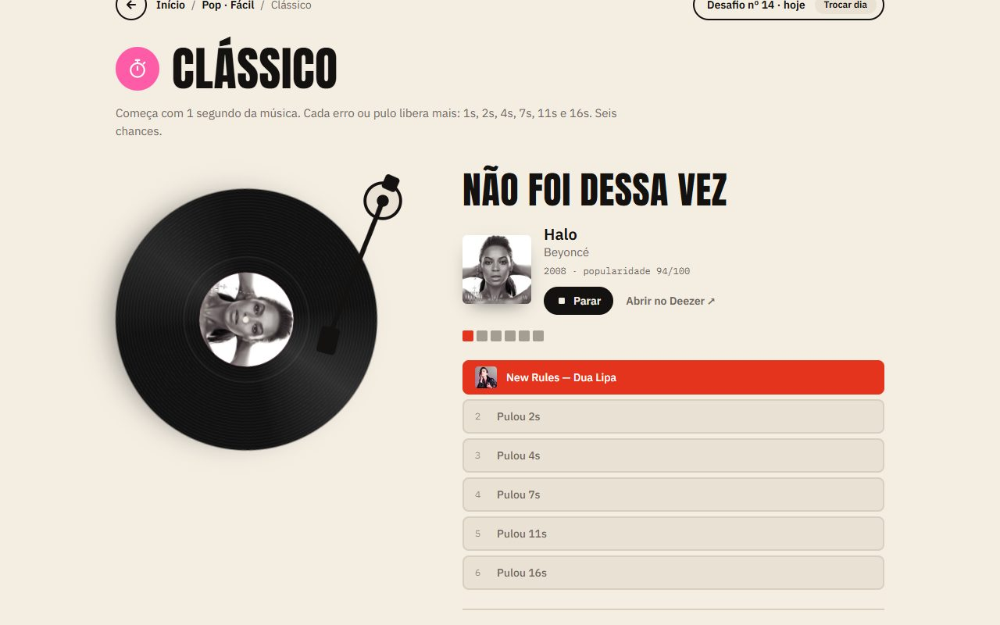
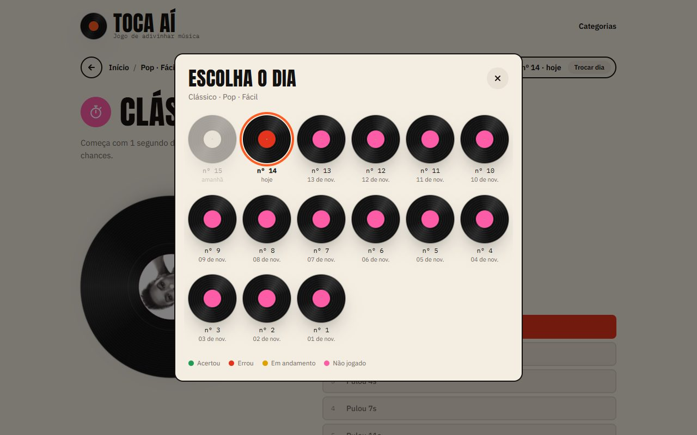

# Toca Aí

Jogo de adivinhar música. Todo dia sai um disco novo: você ouve um pedaço, chuta, e se errar ouve mais um pouco.

Tem funk, sertanejo, pagode, rock, pop, MPB, rap, forró e axé, latina, k-pop, eletrônica, anos 80, 90, 2000 e 2010, os virais do TikTok, o Top Brasil do momento e um mix de tudo. São mais de 3.600 músicas.

## Como funciona

Escolha uma categoria e um nível. Cada combinação tem um desafio novo por dia, igual para todo mundo, e os dias que você perdeu ficam guardados para jogar depois.

- **Fácil**: as músicas mais tocadas da categoria.
- **Médio**: o meio do ranking.
- **Difícil**: o lado B, só pra quem manja.
- **Todas**: qualquer música da categoria.

## Os modos

### Clássico

Começa com 1 segundo de música. Cada erro ou pulo libera mais: 1, 2, 4, 7, 11 e 16 segundos. Seis chances.

### Ao contrário

O trecho toca de trás pra frente, cada vez maior. Nas duas últimas chances ele toca do jeito certo.

### Debaixo d'água

A música começa abafada, como se estivesse tocando na casa do vizinho, e vai ficando nítida a cada tentativa.

### Capa pixelada

Sem som. A capa do álbum aparece em blocos e ganha resolução a cada chute.

### Relâmpago

Dez músicas seguidas, quatro opções cada. Quanto mais rápido você acerta, mais pontos ganha.

### Qual o ano?

Você vê e ouve a música e chuta o ano em que ela estava nas paradas. Acertar na mosca vale 100 pontos.

## Quando acaba

O rótulo do disco vira a capa da música e ela toca inteira.

## Jogando outros dias

Perdeu o desafio de ontem? Em "Trocar dia" aparecem todos os dias, com a cor de cada disco mostrando se você acertou, errou ou ainda não jogou.

## Créditos

Prévias de 30 segundos, capas e fotos: [Deezer](https://www.deezer.com). Projeto sem fins lucrativos.
